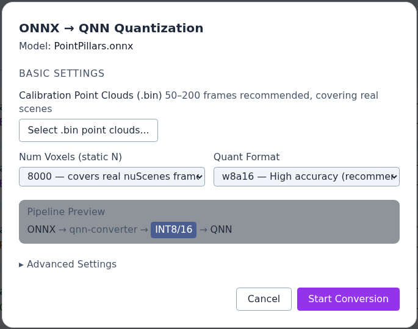
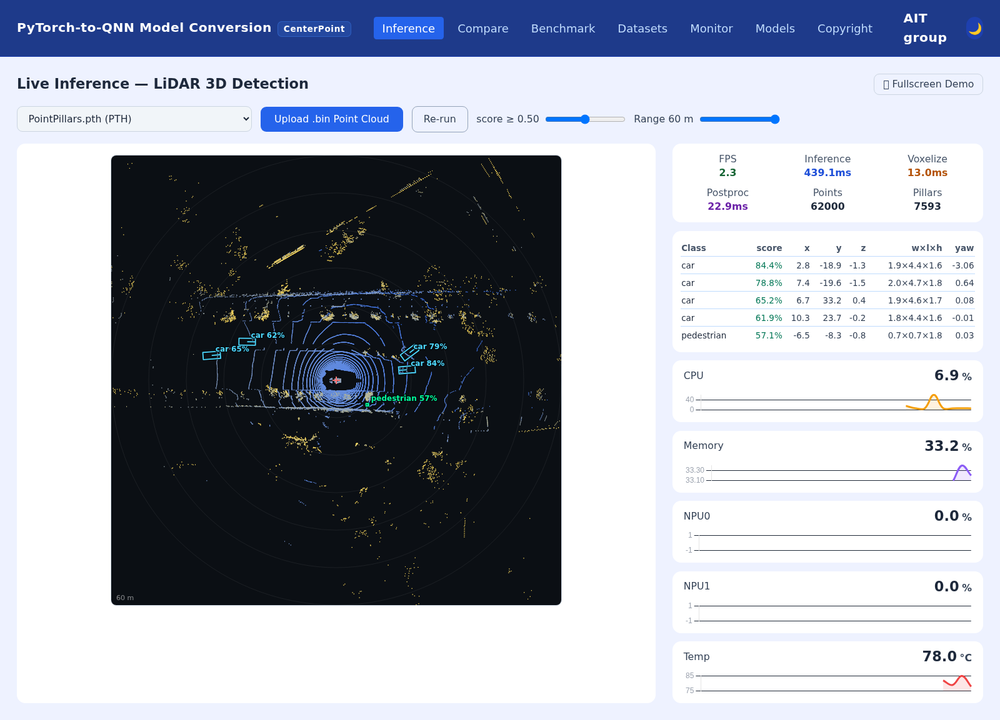

# Qualcomm IQ-9075 Edge AI One-Touch CenterPoint Model Migration Toolkit

## Advantages of IQ-9075

1. IQ-9075 can provide up to 200 sparse TOPS of AI computing power and supports GPU and DSP accelerated computing
2. The Qualcomm Neural Processing (SNPE) SDK and the Qualcomm AI Engine Direct (QNN) can optimize the performance of trained neural networks
3. It supports Yocto and Ubuntu for AI development

## Performance Metrics

- **AI Model**: CenterPoint (PointPillars backbone) — LiDAR 3D Object Detection (QNN)

| Model | Precision | mAP | NDS | Latency on IQ-9075 (HTP) |
|---|---|---|---|---|
| PyTorch (Host PC) | FP32 | 46.00 | 46.38 | — |
| QNN | FP16 | 45.98 | — | — |
| QNN | W8A16 | 33.82 | 37.34 | 31.28 ms |

Evaluated with the official nuScenes detection metrics on 162 frames of the nuScenes validation split (10 classes). FP16 keeps the FP32 accuracy; W8A16 trades accuracy for speed. On-device latency is measured with `qnn-net-run` on the HTP backend.

## Hardware

- **Platform**:  [Qualcomm IQ-9075 EVK](https://www.qualcomm.com/developer/hardware/qualcomm-iq-9075-evaluation-kit-evk)
- **Host PC**: Ubuntu x86_64 PC (NVIDIA GPU recommended), connected to the EVK over USB (ADB)

## Software & Toolkit

- **Qualcomm AI Runtime (QAIRT) SDK**：v2.47.0.260601
- **System:** Yocto (Qualcomm Linux)
- **Host OS:** Ubuntu 20.04 / 22.04 / 24.04

## Background & Solution

### Motivation

- Creating a One-Touch Toolkit to show Qualcomm Edge AI strength on LiDAR 3D perception

### Solution

- One-touch PyTorch-to-QNN model conversion for CenterPoint (FP16 / W8A16)
- On-device QNN benchmark on IQ-9075 EVK: latency and nuScenes mAP / NDS
- Live QNN LiDAR 3D detection with bird's-eye-view visualization in the browser

## Architecture Diagram

The architecture diagram shows the toolkit workflow, corresponding to the colors in the legend on the left

Blue Phase: Convert the PyTorch model into a QNN model, and evaluate the benchmark for the QNN model

Purple Phase: Perform real-time inference and display the results based on the converted QNN model

## Demo

One-touch ONNX-to-QNN quantization

Live LiDAR 3D detection in the browser (PyTorch / ONNX / QNN models selectable)

## Contact
If you require any further information, please feel free to contact:

TW: qualcomm.tw@aitgroup.com.tw

CN: qualcomm.cn@aitgroup.com.tw
